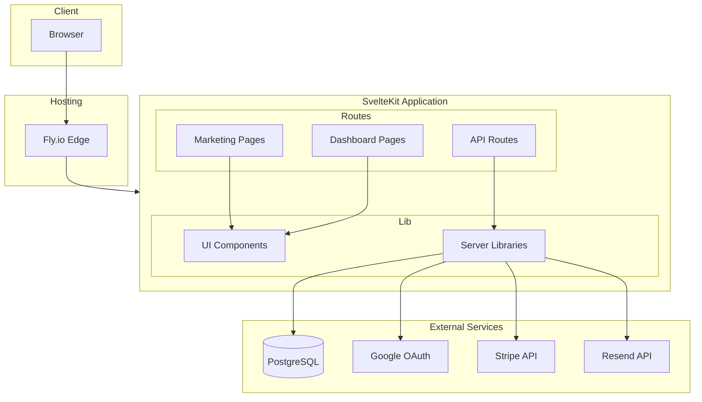
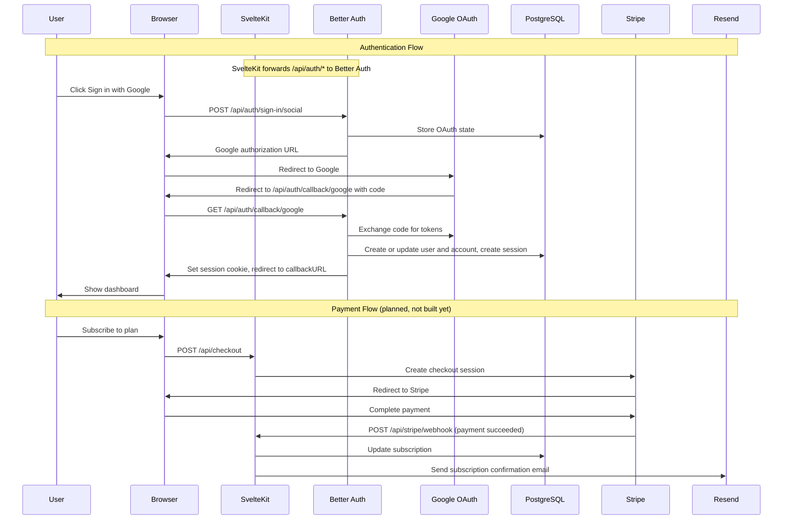
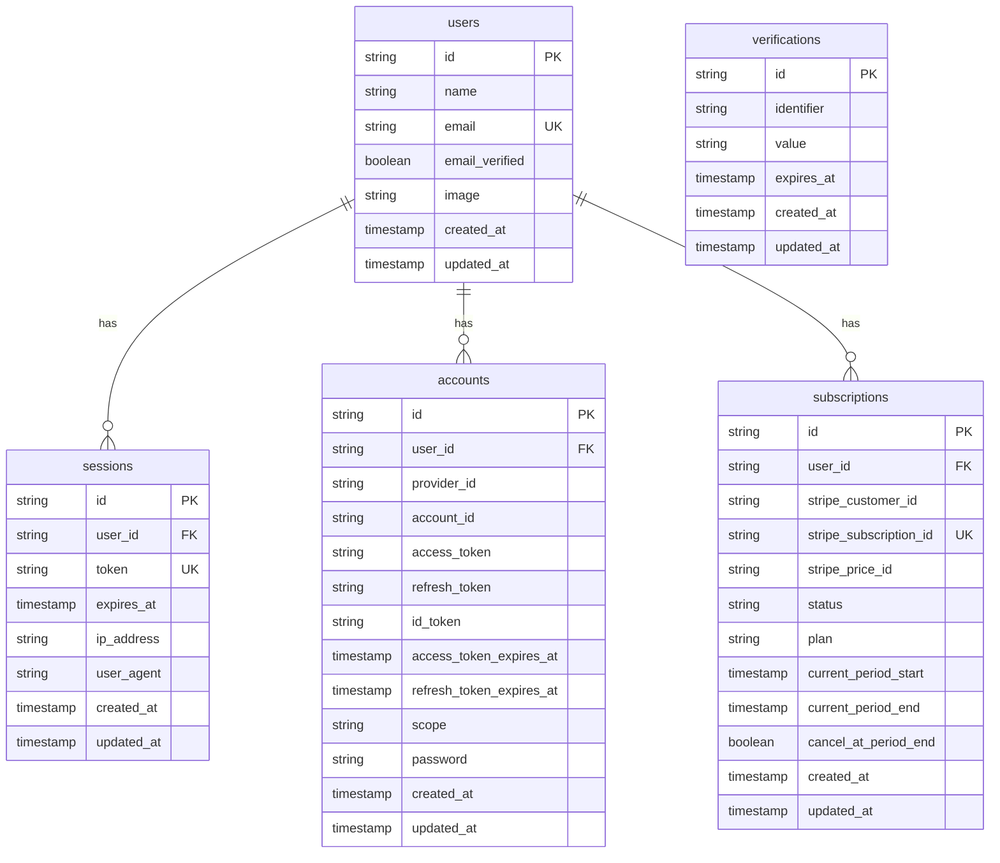

# JabStack Architecture Plan

## Overview

JabStack is a modern, full-stack starter template designed for personal projects that require both marketing pages and user dashboards. It prioritizes developer experience, type safety, and deployment simplicity.

## Technology Stack

| Category | Technology | Purpose |
|----------|------------|---------|
| Runtime | Bun | Fast JavaScript runtime, package manager, and bundler |
| Language | TypeScript | Type-safe JavaScript |
| Framework | SvelteKit | Full-stack web framework with SSR/SSG/SPA support |
| Database | PostgreSQL / PGlite | Any Postgres host in production through postgres.js, PGlite for local development and tests |
| ORM | Drizzle | Type-safe SQL ORM with excellent DX |
| Auth | Better Auth | Modern auth library with OAuth support |
| Payments | Stripe | Payment processing |
| Email | Resend | Transactional email service |
| Dashboard UI | shadcn-svelte + Tailwind CSS | Pre-styled components for dashboard interfaces |
| Marketing UI | Bits UI + Tailwind CSS | Headless primitives for fully custom marketing designs |
| Hosting | Fly.io | Edge deployment platform |
| Unit testing | Vitest | Unit tests next to the code (`src/**/*.test.ts`), with external services mocked |
| Acceptance testing | Playwright | Browser tests in `tests/acceptance/`, each named after a criterion ID (`AC-NN`) in `tests/acceptance/criteria.md` |
| CI | GitHub Actions | Type check, unit tests, criteria check and acceptance tests on every push and pull request |

## Project Structure

```
jabstack/
├── src/
│   ├── lib/
│   │   ├── components/
│   │   │   ├── ui/                    # shadcn-svelte components
│   │   │   ├── dashboard/             # Dashboard-specific components
│   │   │   │   ├── app-sidebar.svelte # Sidebar used by the dashboard layout
│   │   │   │   ├── stats-card.svelte
│   │   │   │   ├── area-chart.svelte
│   │   │   │   └── data-table.svelte
│   │   │   ├── icons/                 # Brand icons for the home page
│   │   │   └── marketing/             # Marketing page components (not created yet)
│   │   ├── hooks/
│   │   │   └── is-mobile.svelte.ts    # Used by the shadcn sidebar
│   │   ├── server/
│   │   │   ├── db/
│   │   │   │   ├── index.ts           # Database client
│   │   │   │   └── schema.ts          # Drizzle schema and row types
│   │   │   ├── auth.ts                # Better Auth configuration
│   │   │   ├── stripe.ts              # Stripe client and helpers
│   │   │   └── email.ts               # Resend client and email templates
│   │   ├── auth-client.ts             # Better Auth client (signIn, signOut, useSession)
│   │   └── utils.ts                   # cn() and number formatting helpers
│   ├── routes/
│   │   ├── +layout.svelte             # Root layout
│   │   ├── +page.svelte               # Marketing home page
│   │   ├── auth/
│   │   │   └── login/+page.server.ts  # Sign-in placeholder (redirects to /dashboard)
│   │   ├── dashboard/
│   │   │   ├── +layout.svelte         # Dashboard layout with sidebar
│   │   │   ├── +layout.server.ts      # Auth guard (added per project)
│   │   │   ├── +page.svelte           # Main dashboard - dashboard-01
│   │   │   └── settings/+page.svelte  # Settings (placeholder page)
│   │   ├── api/
│   │   │   ├── auth/[...all]/+server.ts  # Better Auth handler for /api/auth/* (incl. Google callback)
│   │   │   └── stripe/
│   │   │       └── webhook/+server.ts    # Stripe webhook handler (not built yet)
│   │   └── +error.svelte                 # 404 and error page for every route
│   ├── env.ts                         # Environment variables (defineEnvVars + Zod)
│   ├── app.html                       # HTML template
│   ├── app.css                        # Global styles + Tailwind
│   └── app.d.ts                       # TypeScript declarations
├── drizzle/                           # Database migrations (generated, committed)
├── static/
│   ├── favicon.svg
│   └── robots.txt
├── .env.example                       # Environment variable template
├── .env.test                          # Non-secret values Vitest needs (committed)
├── .github/workflows/ci.yml           # CI: type check, unit tests, criteria check, acceptance tests
├── tests/acceptance/                  # Playwright acceptance tests and criteria.md
├── scripts/check-acceptance-criteria.ts  # Checks every criterion in criteria.md has a test
├── scripts/mcp-setup.ts               # Writes the MCP server config for each AI tool
├── docs/stripe-agent-permissions.md   # What AI agents may do in Stripe
├── playwright.config.ts               # Playwright: builds the app and serves it on port 4173
├── .dockerignore                      # Keeps .env, node_modules and local databases out of the image
├── .gitignore
├── components.json                    # shadcn-svelte configuration (Tailwind 3 registry)
├── Dockerfile                         # Bun-based Docker image for Fly.io
├── fly.toml                           # Fly.io configuration
├── drizzle.config.ts                  # Drizzle Kit configuration
├── tailwind.config.ts                 # Tailwind CSS configuration
├── tsconfig.json                      # TypeScript configuration (extends $app/tsconfig)
├── vite.config.ts                     # Vite and SvelteKit configuration (Bun adapter)
├── vitest.config.ts                   # Vitest configuration
├── package.json
├── bun.lock                           # Bun lock file
├── README.md
├── AGENTS.md                          # Instructions for AI coding agents
├── CLAUDE.md                          # Imports AGENTS.md for Claude Code
└── GEMINI.md                          # Imports AGENTS.md for Gemini CLI
```

## Architecture Diagram



## Data Flow Diagram



The payment flow is planned but not built. `src/lib/server/stripe.ts` has helpers for checkout sessions, billing portal sessions and customers, and `src/lib/server/email.ts` has subscription email templates, but no route calls them. The webhook handler belongs at `src/routes/api/stripe/webhook/+server.ts`, which is where `bun run stripe:cli` forwards events.

No email is sent on sign-up yet. To send one, call `sendWelcomeEmail` from `src/lib/server/email.ts` in Better Auth's `databaseHooks.user.create.after`.

## Database Schema



`users`, `sessions`, `accounts` and `verifications` are Better Auth's tables (`verifications` holds short-lived values such as OAuth state). Better Auth checks them against its expected schema at startup. Timestamps are `timestamp with time zone` columns.

## Environment Variables

```bash
# Database
DATABASE_URL=               # Postgres connection string, or file:.pglite/dev for PGlite
DATABASE_MIGRATION_URL=     # Optional direct connection string for migrations
DATABASE_PREPARED_STATEMENTS=  # Optional, default true. false for poolers that reject them

# Auth
BETTER_AUTH_SECRET=         # Random secret for session encryption
GOOGLE_CLIENT_ID=           # Google OAuth client ID
GOOGLE_CLIENT_SECRET=       # Google OAuth client secret

# Stripe
STRIPE_SECRET_KEY=          # Stripe secret (sk_) or restricted (rk_) key
STRIPE_WEBHOOK_SECRET=      # Stripe webhook signing secret
PUBLIC_STRIPE_PUBLISHABLE_KEY=  # Stripe publishable key - client-safe

# Email
RESEND_API_KEY=             # Resend API key
EMAIL_FROM=                 # Optional sender, e.g. "JabStack <noreply@yourdomain.com>"

# App
PUBLIC_APP_URL=             # Application URL - https://your-app.fly.dev
```

## Key Implementation Details

### 1. SvelteKit Configuration and Bun Adapter

SvelteKit 3 reads its configuration from the `sveltekit()` Vite plugin. There's no `svelte.config.js`.

```typescript
// vite.config.ts
import adapter from '@sveltejs/adapter-bun';
import { sveltekit } from '@sveltejs/kit/vite';
import { defineConfig } from 'vite';

export default defineConfig({
	plugins: [
		sveltekit({
			adapter: adapter()
		})
	]
});
```

`@sveltejs/adapter-bun` calls Bun's build API, so the `build` script runs Vite under Bun (`bun --bun vite build`). The output starts with `bun ./build/index.js`. The adapter assumes requests arrived over HTTPS, which holds behind Fly's TLS-terminating proxy.

`src/lib` is imported as `#lib/...`, a subpath import declared under `imports` in `package.json`. SvelteKit 3 has no `$lib` alias.

### 2. Environment Variables

Every variable is declared in `src/env.ts` with SvelteKit's `defineEnvVars` and validated with Zod. Server code imports private values from `$app/env/private` and public values from `$app/env/public`. `.env.example` lists every variable.

```typescript
// src/env.ts (abridged)
import { defineEnvVars } from '@sveltejs/kit/env';
import { building } from '$app/env';
import { z } from 'zod';

// While building, a missing secret becomes a placeholder. At startup it's required.
const secret = (schema: z.ZodString, buildPlaceholder: string) =>
	building ? z.string().optional().transform((value) => value || buildPlaceholder) : schema;

export const variables = defineEnvVars({
	PUBLIC_APP_URL: {
		public: true,
		static: true,
		schema: z.url('PUBLIC_APP_URL must be a valid URL')
	},
	DATABASE_URL: {
		schema: secret(z.string().regex(/^(postgres(ql)?:\/\/|file:|memory:\/\/$)/), 'memory://')
	},
	STRIPE_SECRET_KEY: {
		// sk_ or a restricted rk_ key. Live keys are refused under `bun run dev`.
		schema: secret(z.string().regex(/^(sk|rk)_/), 'sk_build_placeholder')
	}
	// ... Better Auth, Google, Stripe webhook and publishable key, Resend
});
```

- Variables are dynamic by default, so they're read when the server starts. That's how secrets set with `fly secrets set` reach the app.
- `PUBLIC_APP_URL` is the only static variable. It's written into the build from the `fly.toml` build argument.
- If a value is missing or invalid, the app refuses to start and lists every bad variable.
- The build loads server modules (Better Auth, the database client) without any secrets. The placeholders let it finish, and they never reach a running server.

### 3. Database Setup with Drizzle

PGlite for development and tests (`DATABASE_URL=file:.pglite/dev`), any Postgres host in production. `DATABASE_URL` picks the driver:

```typescript
// src/lib/server/db/index.ts (abridged)
function createClient(url: string): Client {
	if (/^postgres(ql)?:\/\//.test(url)) {
		// SSL settings come from the URL, e.g. ?sslmode=require
		return postgres(url, { prepare: DATABASE_PREPARED_STATEMENTS });
	}
	// file:<folder> or memory://: Postgres compiled to WebAssembly, in this process
	return new PGlite(url.replace(/^file:/, ''));
}

// The build never queries, so it gets a postgres.js client that never connects
export const db = building ? connect('postgres://build-placeholder@localhost/build') : connect(DATABASE_URL);
```

- `connect()` keeps each client on `globalThis`, so a Vite reload during development doesn't open a second PGlite on the same folder. PGlite doesn't lock its folder, and two processes using it can corrupt it.
- On `sveltekit:shutdown`, which the Bun adapter emits after SIGTERM or SIGINT, the client closes so the process can exit.
- `prepare: false` (`DATABASE_PREPARED_STATEMENTS=false`) is for poolers in transaction mode that reject prepared statements, such as Supabase's on port 6543.

`drizzle.config.ts` uses the `postgresql` dialect. It connects with `DATABASE_MIGRATION_URL` if set, otherwise `DATABASE_URL`, through postgres.js for a `postgres://` URL or the `pglite` driver for a `file:` URL. Migrations are generated into `drizzle/` and committed.

### 4. Better Auth Configuration

```typescript
// src/lib/server/auth.ts (abridged)
import { betterAuth } from 'better-auth';
import { drizzleAdapter } from 'better-auth/adapters/drizzle';
import { db } from './db/index.js';
import * as schema from './db/schema.js';

export const auth = betterAuth({
  database: drizzleAdapter(db, {
    provider: 'pg',
    schema,
    usePlural: true // tables are users, sessions, accounts, verifications
  }),
  secret: BETTER_AUTH_SECRET,
  baseURL: PUBLIC_APP_URL, // callback URLs are built from this
  socialProviders: {
    google: {
      clientId: GOOGLE_CLIENT_ID,
      clientSecret: GOOGLE_CLIENT_SECRET
    }
  },
  emailAndPassword: { enabled: false }
});
```

The route `src/routes/api/auth/[...all]/+server.ts` passes every `/api/auth/*` request to `auth.handler`. Google redirects back to `/api/auth/callback/google`, so that URL (prefixed with `PUBLIC_APP_URL`) must be an authorized redirect URI on the Google OAuth client.

### 5. Dockerfile and Fly.io

```dockerfile
# Dockerfile (comments removed)
FROM oven/bun:1 AS builder
WORKDIR /app
ARG PUBLIC_APP_URL=$PUBLIC_APP_URL
ENV PUBLIC_APP_URL=$PUBLIC_APP_URL
COPY package.json bun.lock ./
RUN bun install --frozen-lockfile
COPY . .
RUN bun run build

FROM oven/bun:1-slim
WORKDIR /app
COPY --from=builder /app/build ./build
COPY --from=builder /app/package.json ./
COPY --from=builder /app/node_modules ./node_modules
COPY --from=builder /app/drizzle ./drizzle
COPY --from=builder /app/drizzle.config.ts ./
ENV NODE_ENV=production
ENV PORT=3000
ENV HOST=0.0.0.0
EXPOSE 3000
CMD ["bun", "./build/index.js"]
```

- `fly.toml` passes `PUBLIC_APP_URL` as a build argument, because it's a static variable written into the build. The build needs no other variables.
- `.dockerignore` keeps `.env`, `node_modules`, `.svelte-kit`, local databases and `.git` out of the build context.
- Secrets come from `fly secrets set` and are read when the server starts.
- `release_command = "bun run db:migrate"` in `fly.toml` applies migrations in a temporary Machine before each release goes live. It uses the app's secrets: `DATABASE_MIGRATION_URL` if set, otherwise `DATABASE_URL`. That's why the runtime image includes `drizzle/`, `drizzle.config.ts` and all of `node_modules` (drizzle-kit is a dev dependency).

## MCP Server Configurations

Each AI tool reads MCP servers from its own file, in its own format. `scripts/mcp-setup.ts` holds one list of servers, and `bun run mcp:setup <tool>` writes it for that tool: `.mcp.json` and `.claude/settings.json` for Claude Code, `.cursor/mcp.json`, `.vscode/mcp.json`, `.kiro/settings/mcp.json`, `.codex/config.toml` or `.gemini/settings.json`. Windsurf has no project file, so the script prints its config. Existing files are updated in place.

| Server | Connection | Authentication |
|--------|------------|----------------|
| `stripe` | Stripe's hosted server at `https://mcp.stripe.com` | OAuth to the project's sandbox, or with `--agent-key` a sandbox Agent API key from `STRIPE_AGENT_API_KEY` |
| `shadcn` | `bunx --bun shadcn@latest mcp` | Nothing |
| `svelte` | `bunx --bun sv mcp` | Nothing |

- Which Stripe tools work depends on the OAuth grant or the key's permissions. `docs/stripe-agent-permissions.md` records what they should be.
- Where the tool allows it, the script makes it ask before each Stripe tool call: an `ask` rule in `.claude/settings.json`, an empty `autoApprove` for Kiro, `default_tools_approval_mode = "prompt"` for Codex and `trust: false` for Gemini CLI.
- `--agent-key` leaves the Stripe prompts out, because Claude Code's `ask` rule would override an unattended run's own approval. It never adds an allow setting. Unattended runs refuse tool calls that need approval, so each run allows Stripe's tools itself, for example `claude -p "..." --allowedTools "mcp__stripe__*"`. Files written this way must never be committed, and `ci.yml` fails if committed MCP config uses `STRIPE_AGENT_API_KEY`.
- With `STRIPE_AGENT_API_KEY` set, `--agent-key` refuses a live-mode key. The app's `src/env.ts` refuses a live `STRIPE_SECRET_KEY` under `bun run dev`.
- `STRIPE_AGENT_API_KEY` is separate from the app's `STRIPE_SECRET_KEY`, so agents never get the app's key.

## UI Library Strategy

JabStack uses two complementary UI libraries for different purposes:

### Dashboard Pages - shadcn-svelte

- **Location**: `/src/lib/components/ui/` and `/src/routes/dashboard/`
- **Why**: Pre-styled, consistent components that work out of the box
- **Components**: Buttons, cards, tables, charts, sidebar, forms, dialogs
- **Benefit**: Rapid dashboard development with professional appearance

### Marketing Pages - Bits UI

- **Location**: `/src/routes/` (non-dashboard). Reusable components go in `/src/lib/components/marketing/`, which doesn't exist yet; the home page imports `bits-ui` directly.
- **Why**: Headless primitives that provide accessibility and behavior without styling
- **Components**: Accordions, dialogs, menus, tabs, tooltips - all unstyled
- **Benefit**: Complete design freedom for unique marketing page aesthetics

This separation allows:

- Consistent, polished dashboard UX across all projects
- Unique, branded marketing pages per project
- Both libraries share Tailwind CSS for styling

## Dashboard Components - dashboard-01

The dashboard implements the shadcn dashboard-01 block with:

1. **Collapsible Sidebar** (`app-sidebar.svelte`) - Navigation with icons, collapsible to icon-only mode. It links to Dashboard and a placeholder Settings page. Projects add a link as they add each page.
2. **Stats Cards** - Four metric cards showing key statistics
3. **Area Chart** - Chart.js time-series chart with 3-month, 30-day and 7-day buttons
4. **Data Table** - Table with tab buttons. The tabs don't change the rows yet, and there's no sorting or filtering.

All components use static placeholder data for flexibility across different project types.

## Deployment Checklist

1. Create a PostgreSQL database on any host and copy its connection strings (pooled and direct, if it has both)
2. Set up Google OAuth credentials, with `https://<your-app>.fly.dev/api/auth/callback/google` as an authorized redirect URI
3. Create Stripe account and get API keys
4. Create Resend account and get API key
5. Set `app` and `PUBLIC_APP_URL` (under `[build.args]`) in `fly.toml`
6. Create Fly.io app: `fly apps create <your-app>`
7. Set secrets: `fly secrets set DATABASE_URL=... DATABASE_MIGRATION_URL=...` and every other variable in `src/env.ts` except `PUBLIC_APP_URL`. The app won't start if one is missing.
8. Deploy: `fly deploy`. Migrations run automatically before the release goes live.

## Next Steps After Setup

When starting a new project from JabStack:

1. Clone the repository
2. Update `package.json` with new project name
3. Create a new PostgreSQL database for the project
4. Update environment variables, then run `bun run db:migrate`
5. Customize dashboard sidebar navigation in `app-sidebar.svelte`
6. Modify database schema for project needs, then generate and commit a migration
7. Update marketing home page content
8. Replace the `/auth/login` placeholder and add a dashboard guard if the project needs sign-in (see `AGENTS.md`)
9. Deploy to Fly.io with new app name
