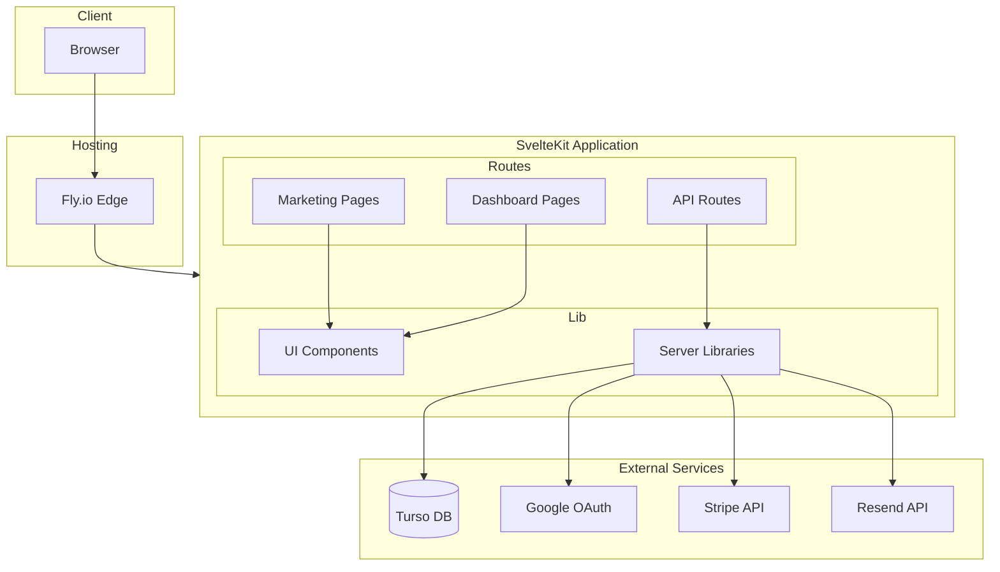
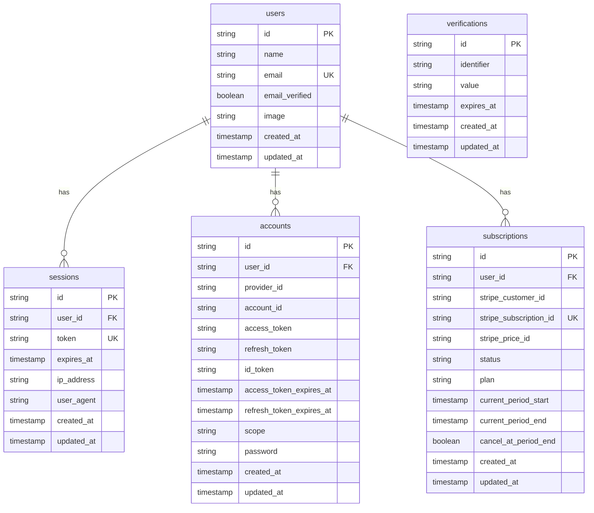

# JabStack Architecture Plan

## Overview

JabStack is a modern, full-stack starter template designed for personal projects that require both marketing pages and user dashboards. It prioritizes developer experience, type safety, and deployment simplicity.

## Technology Stack

| Category | Technology | Purpose |
|----------|------------|---------|
| Runtime | Bun | Fast JavaScript runtime, package manager, and bundler |
| Language | TypeScript | Type-safe JavaScript |
| Framework | SvelteKit | Full-stack web framework with SSR/SSG/SPA support |
| Database | Turso / SQLite | LibSQL for production, SQLite for local development |
| ORM | Drizzle | Type-safe SQL ORM with excellent DX |
| Auth | Better Auth | Modern auth library with OAuth support |
| Payments | Stripe | Payment processing |
| Email | Resend | Transactional email service |
| Dashboard UI | shadcn-svelte + Tailwind CSS | Pre-styled components for dashboard interfaces |
| Marketing UI | Bits UI + Tailwind CSS | Headless primitives for fully custom marketing designs |
| Hosting | Fly.io | Edge deployment platform |
| Testing | Vitest | Unit testing framework |

## Project Structure

```
jabstack/
├── src/
│   ├── lib/
│   │   ├── components/
│   │   │   ├── ui/                    # shadcn-svelte components
│   │   │   ├── dashboard/             # Dashboard-specific components
│   │   │   │   ├── app-sidebar.svelte # Sidebar used by the dashboard layout
│   │   │   │   ├── sidebar.svelte     # Older sidebar, not used
│   │   │   │   ├── stats-card.svelte
│   │   │   │   ├── area-chart.svelte
│   │   │   │   └── data-table.svelte
│   │   │   ├── icons/                 # Brand icons for the home page
│   │   │   └── marketing/             # Marketing page components (not created yet)
│   │   ├── hooks/
│   │   │   └── is-mobile.svelte.ts    # Used by the shadcn sidebar
│   │   ├── server/
│   │   │   ├── db/
│   │   │   │   ├── index.ts           # Database client
│   │   │   │   └── schema.ts          # Drizzle schema and row types
│   │   │   ├── auth.ts                # Better Auth configuration
│   │   │   ├── stripe.ts              # Stripe client and helpers
│   │   │   └── email.ts               # Resend client and email templates
│   │   ├── auth-client.ts             # Better Auth client (signIn, signOut, useSession)
│   │   ├── env.ts                     # Zod schemas for env vars (not imported yet)
│   │   └── utils.ts                   # cn() and number formatting helpers
│   ├── routes/
│   │   ├── +layout.svelte             # Root layout
│   │   ├── +page.svelte               # Marketing home page
│   │   ├── auth/
│   │   │   └── login/+page.server.ts  # Sign-in placeholder (redirects to /dashboard)
│   │   ├── dashboard/
│   │   │   ├── +layout.svelte         # Dashboard layout with sidebar
│   │   │   ├── +layout.server.ts      # Auth guard (added per project)
│   │   │   ├── +page.svelte           # Main dashboard - dashboard-01
│   │   │   └── settings/+page.svelte  # User settings (not built yet)
│   │   ├── api/
│   │   │   ├── auth/[...all]/+server.ts  # Better Auth handler for /api/auth/* (incl. Google callback)
│   │   │   └── stripe/
│   │   │       └── webhook/+server.ts    # Stripe webhook handler (not built yet)
│   │   └── [...catchall]/+page.svelte    # 404 page (not built yet)
│   ├── app.html                       # HTML template
│   ├── app.css                        # Global styles + Tailwind
│   └── app.d.ts                       # TypeScript declarations
├── drizzle/                           # Database migrations (generated, committed)
├── static/
│   ├── favicon.svg
│   └── robots.txt
├── tests/                             # Vitest tests (not created yet)
├── .env.example                       # Environment variable template
├── .gitignore
├── components.json                    # shadcn-svelte configuration (Tailwind 3 registry)
├── Dockerfile                         # Bun-based Docker image for Fly.io
├── fly.toml                           # Fly.io configuration
├── drizzle.config.ts                  # Drizzle Kit configuration
├── svelte.config.js                   # SvelteKit configuration
├── tailwind.config.ts                 # Tailwind CSS configuration
├── tsconfig.json                      # TypeScript configuration
├── vite.config.ts                     # Vite configuration
├── vitest.config.ts                   # Vitest configuration
├── package.json
├── bun.lock                           # Bun lock file
├── README.md
├── AGENTS.md                          # Instructions for AI coding agents
└── CLAUDE.md                          # Imports AGENTS.md for Claude Code
```

## Architecture Diagram



## Data Flow Diagram


The payment flow is planned but not built. `src/lib/server/stripe.ts` has helpers for checkout sessions, billing portal sessions and customers, and `src/lib/server/email.ts` has subscription email templates, but no route calls them. The webhook handler belongs at `src/routes/api/stripe/webhook/+server.ts`, which is where `bun run stripe:cli` forwards events.

No email is sent on sign-up yet. To send one, call `sendWelcomeEmail` from `src/lib/server/email.ts` in Better Auth's `databaseHooks.user.create.after`.

## Database Schema



`users`, `sessions`, `accounts` and `verifications` are Better Auth's tables (`verifications` holds short-lived values such as OAuth state). Better Auth checks them against its expected schema at startup. Timestamps are stored as milliseconds.

## Environment Variables

```bash
# Database
DATABASE_URL=               # Turso database URL - libsql://...
DATABASE_AUTH_TOKEN=        # Turso auth token

# Auth
BETTER_AUTH_SECRET=         # Random secret for session encryption
GOOGLE_CLIENT_ID=           # Google OAuth client ID
GOOGLE_CLIENT_SECRET=       # Google OAuth client secret

# Stripe
STRIPE_SECRET_KEY=          # Stripe secret key
STRIPE_WEBHOOK_SECRET=      # Stripe webhook signing secret
PUBLIC_STRIPE_PUBLISHABLE_KEY=  # Stripe publishable key - client-safe

# Email
RESEND_API_KEY=             # Resend API key

# App
PUBLIC_APP_URL=             # Application URL - https://your-app.fly.dev
```

## Key Implementation Details

### 1. SvelteKit Adapter for Bun

```javascript
// svelte.config.js
import adapter from 'svelte-adapter-bun';

const config = {
  kit: {
    adapter: adapter(),
    alias: {
      $components: 'src/lib/components',
      '$components/*': 'src/lib/components/*'
    }
  }
};

export default config;
```

`svelte-adapter-bun` is deprecated. Its replacement, the official `@sveltejs/adapter-bun`, requires SvelteKit 3. Nothing uses the `$components` alias.

### 2. Environment Variables

Server modules import secrets from `$env/static/private` and public values from `$env/static/public` directly. `.env.example` lists every variable.

`src/lib/env.ts` validates all of them with Zod and exports a combined `env` object, but nothing imports it yet, so the checks never run:

```typescript
// src/lib/env.ts (abridged)
const privateEnvSchema = z.object({
  DATABASE_URL: z.string().min(1, 'DATABASE_URL is required'),
  DATABASE_AUTH_TOKEN: z.string().optional(),
  BETTER_AUTH_SECRET: z.string().min(32, 'BETTER_AUTH_SECRET must be at least 32 characters'),
  STRIPE_SECRET_KEY: z.string().startsWith('sk_', 'STRIPE_SECRET_KEY must start with sk_'),
  // ... Google, Stripe webhook and Resend keys
});

const privateEnvResult = privateEnvSchema.safeParse({ DATABASE_URL, DATABASE_AUTH_TOKEN /* ... */ });
if (!privateEnvResult.success) throw new Error('Invalid private environment variables');
// The public variables are checked the same way

export const env = { ...privateEnvResult.data, ...publicEnvResult.data };
```

Known issue: SvelteKit writes `$env/static/private` values into the build, so secrets set at runtime (`fly secrets set`) don't reach the app. Server code should move to `$env/dynamic/private`.

### 3. Database Setup with Drizzle

Local SQLite file for development (`DATABASE_URL=file:local.db`), Turso for production:

```typescript
// src/lib/server/db/index.ts
import { drizzle } from 'drizzle-orm/libsql';
import { createClient } from '@libsql/client';
import { DATABASE_URL, DATABASE_AUTH_TOKEN } from '$env/static/private';
import * as schema from './schema.js';

const client = createClient({
  url: DATABASE_URL,
  authToken: DATABASE_AUTH_TOKEN || undefined
});

export const db = drizzle(client, { schema });

// Re-export schema for convenience
export * from './schema.js';
```

`drizzle.config.ts` uses the `turso` dialect, which works with both a `file:` URL and a Turso URL plus auth token. Migrations are generated into `drizzle/` and committed.

### 4. Better Auth Configuration

```typescript
// src/lib/server/auth.ts (abridged)
import { betterAuth } from 'better-auth';
import { drizzleAdapter } from 'better-auth/adapters/drizzle';
import { db } from './db/index.js';
import * as schema from './db/schema.js';

export const auth = betterAuth({
  database: drizzleAdapter(db, {
    provider: 'sqlite',
    schema,
    usePlural: true // tables are users, sessions, accounts, verifications
  }),
  secret: BETTER_AUTH_SECRET,
  baseURL: PUBLIC_APP_URL, // callback URLs are built from this
  socialProviders: {
    google: {
      clientId: GOOGLE_CLIENT_ID,
      clientSecret: GOOGLE_CLIENT_SECRET
    }
  },
  emailAndPassword: { enabled: false }
});
```

The route `src/routes/api/auth/[...all]/+server.ts` passes every `/api/auth/*` request to `auth.handler`. Google redirects back to `/api/auth/callback/google`, so that URL (prefixed with `PUBLIC_APP_URL`) must be an authorized redirect URI on the Google OAuth client.

### 5. Dockerfile and Fly.io

```dockerfile
# Dockerfile (comments removed)
FROM oven/bun:1 AS builder
WORKDIR /app
ARG PUBLIC_APP_URL=$PUBLIC_APP_URL
ENV PUBLIC_APP_URL=$PUBLIC_APP_URL
COPY package.json bun.lock ./
RUN bun install --frozen-lockfile
COPY . .
RUN bun run build

FROM oven/bun:1-slim
WORKDIR /app
COPY --from=builder /app/build ./build
COPY --from=builder /app/package.json ./
COPY --from=builder /app/node_modules ./node_modules
COPY --from=builder /app/drizzle ./drizzle
COPY --from=builder /app/drizzle.config.ts ./
ENV NODE_ENV=production
ENV PORT=3000
ENV HOST=0.0.0.0
EXPOSE 3000
CMD ["bun", "./build/index.js"]
```

- `fly.toml` passes `PUBLIC_APP_URL` as a build argument, because SvelteKit writes public values into the build.
- `release_command = "bun run db:migrate"` in `fly.toml` applies migrations in a temporary Machine before each release goes live. That's why the runtime image includes `drizzle/`, `drizzle.config.ts` and all of `node_modules` (drizzle-kit is a dev dependency).
- There's no `.dockerignore`, so `COPY . .` also copies the local `.env`, `node_modules` and `.git` into the build stage. Combined with the `$env/static/private` issue above, the build uses the local `.env` values.

## MCP Server Configurations

`.mcp/mcp.json` runs four MCP servers with `bunx --bun`:

| Server | Package | Uses |
|--------|---------|------|
| `stripe` | `@stripe/mcp --tools=all` | `STRIPE_SECRET_KEY`. All tools are enabled, so consider a restricted key |
| `turso` | `@turso/mcp` | `DATABASE_URL`, `DATABASE_AUTH_TOKEN` |
| `shadcn` | `shadcn@latest mcp` | Nothing |
| `svelte` | `sv mcp` | Nothing |

## UI Library Strategy

JabStack uses two complementary UI libraries for different purposes:

### Dashboard Pages - shadcn-svelte

- **Location**: `/src/lib/components/ui/` and `/src/routes/dashboard/`
- **Why**: Pre-styled, consistent components that work out of the box
- **Components**: Buttons, cards, tables, charts, sidebar, forms, dialogs
- **Benefit**: Rapid dashboard development with professional appearance

### Marketing Pages - Bits UI

- **Location**: `/src/routes/` (non-dashboard). Reusable components go in `/src/lib/components/marketing/`, which doesn't exist yet; the home page imports `bits-ui` directly.
- **Why**: Headless primitives that provide accessibility and behavior without styling
- **Components**: Accordions, dialogs, menus, tabs, tooltips - all unstyled
- **Benefit**: Complete design freedom for unique marketing page aesthetics

This separation allows:

- Consistent, polished dashboard UX across all projects
- Unique, branded marketing pages per project
- Both libraries share Tailwind CSS for styling

## Dashboard Components - dashboard-01

The dashboard implements the shadcn dashboard-01 block with:

1. **Collapsible Sidebar** (`app-sidebar.svelte`) - Navigation with icons, collapsible to icon-only mode. Most links point to pages that don't exist yet.
2. **Stats Cards** - Four metric cards showing key statistics
3. **Area Chart** - Chart.js time-series chart with 3-month, 30-day and 7-day buttons
4. **Data Table** - Table with tab buttons. The tabs don't change the rows yet, and there's no sorting or filtering.

All components use static placeholder data for flexibility across different project types.

## Deployment Checklist

1. Create Turso database and get credentials
2. Set up Google OAuth credentials, with `https://<your-app>.fly.dev/api/auth/callback/google` as an authorized redirect URI
3. Create Stripe account and get API keys
4. Create Resend account and get API key
5. Set `app` and `PUBLIC_APP_URL` (under `[build.args]`) in `fly.toml`
6. Create Fly.io app: `fly apps create <your-app>`
7. Set secrets: `fly secrets set DATABASE_URL=... DATABASE_AUTH_TOKEN=...` and the other keys (see the known issue under Environment Variables)
8. Deploy: `fly deploy`. Migrations run automatically before the release goes live.

## Next Steps After Setup

When starting a new project from JabStack:

1. Clone the repository
2. Update `package.json` with new project name
3. Create new Turso database for the project
4. Update environment variables, then run `bun run db:migrate`
5. Customize dashboard sidebar navigation in `app-sidebar.svelte`
6. Modify database schema for project needs, then generate and commit a migration
7. Update marketing home page content
8. Replace the `/auth/login` placeholder and add a dashboard guard if the project needs sign-in (see `AGENTS.md`)
9. Deploy to Fly.io with new app name
